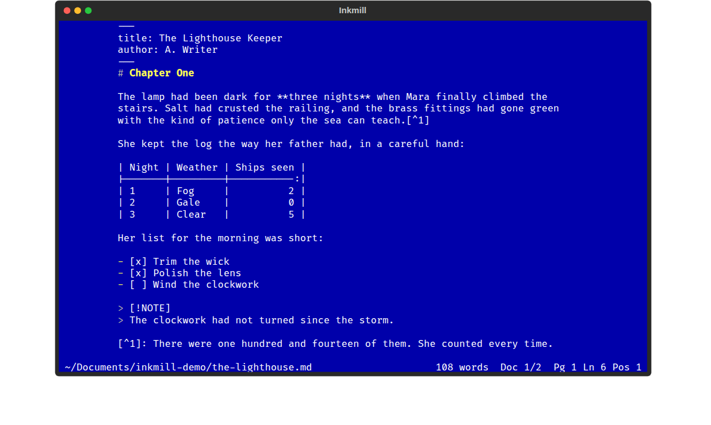
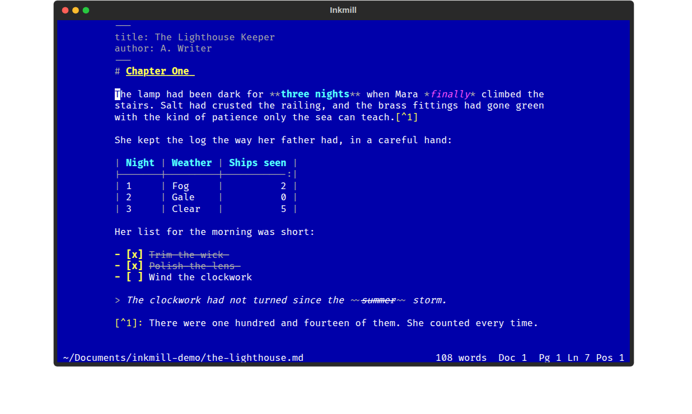
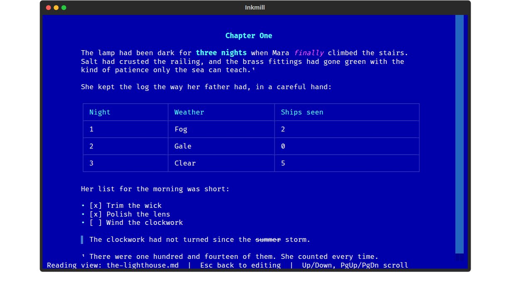
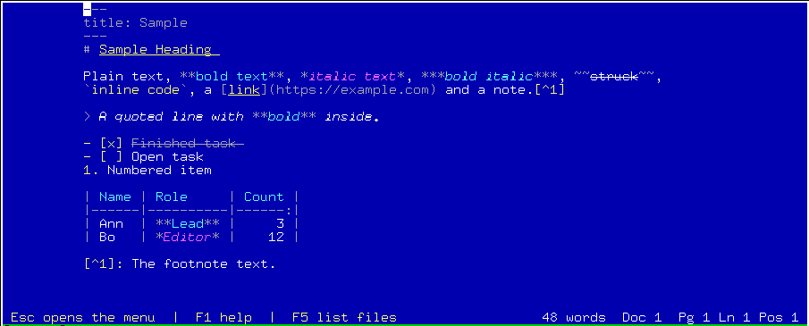
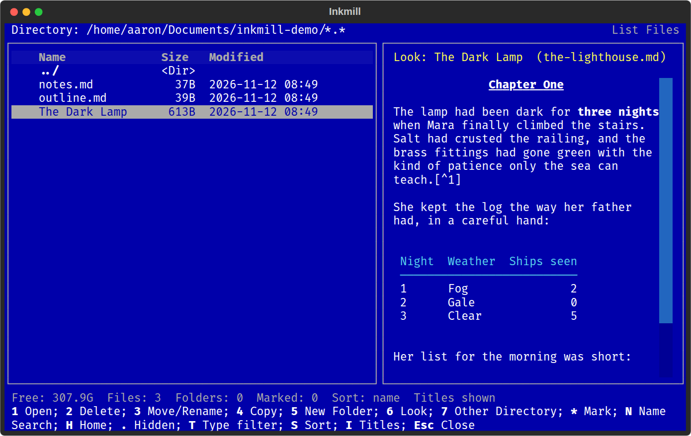
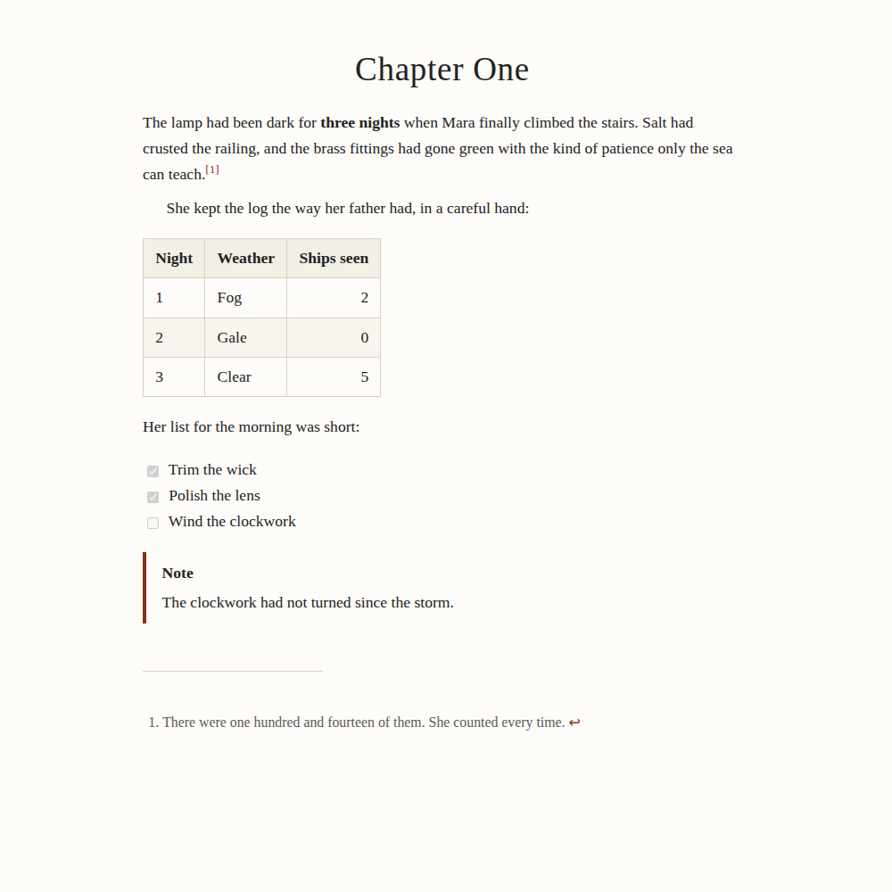
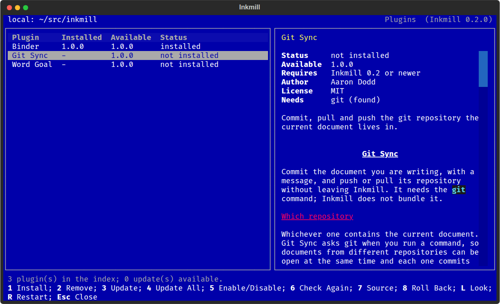
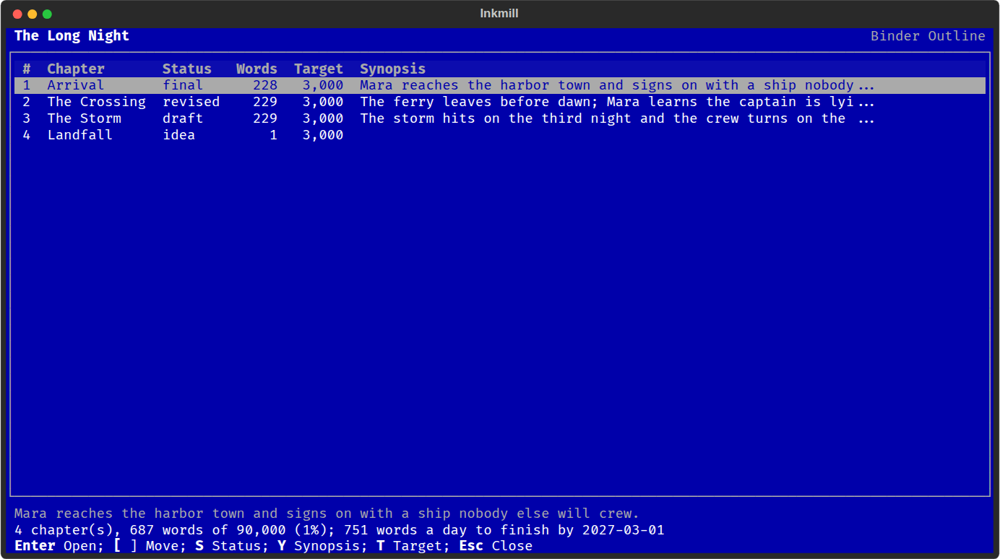
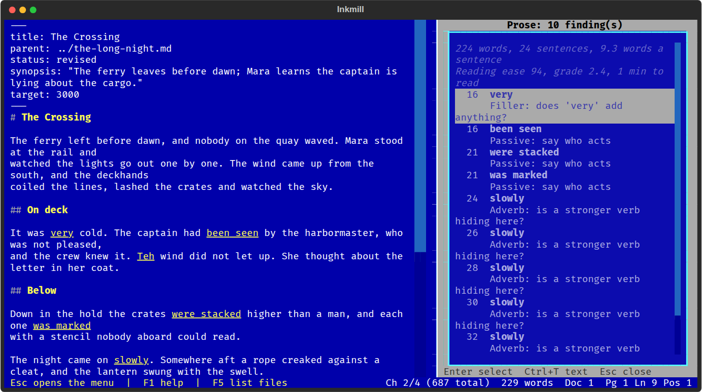
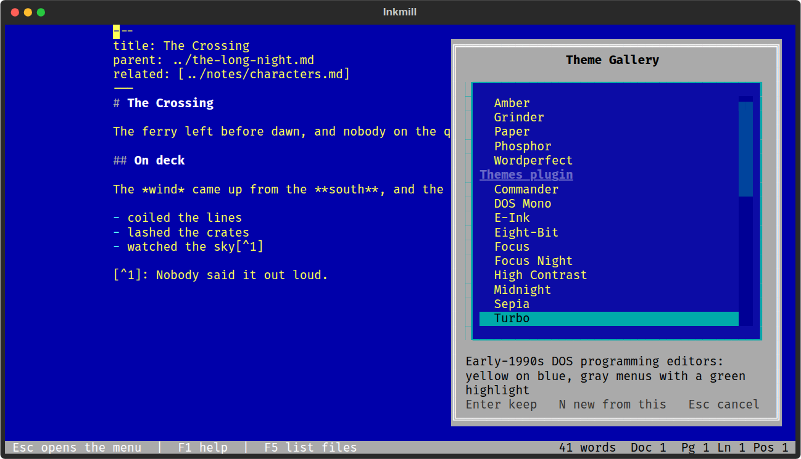

# Inkmill

Inkmill is a word processor for the terminal. It keeps the screen empty while
you write and puts everything else one keystroke away. Documents are plain
Markdown files, and the HTML export is styled with CSS you can swap or write
yourself.

It takes its spirit from [WordGrinder](https://github.com/davidgiven/wordgrinder)
(a menu that stays out of the way until you ask for it) and its look from
WordPerfect 5.1 for DOS: white text on a blue screen, gray pull-down menus,
a status line reading `Doc 1 Pg 1 Ln 12 Pos 40`, and an F5 List Files screen
for managing documents without leaving the editor.



It runs anywhere Python 3.11+ runs, including Windows Terminal, Linux and
macOS terminals, and Termux on Android. Every dependency is pure Python.

## Install

```sh
pipx install git+https://github.com/aarondodd/inkmill.git
# optional: Markdown highlighting in the editor (needs tree-sitter wheels)
pipx inject inkmill "textual[syntax]"
```

Then run `inkmill`, or `inkmill chapter-one.md notes.md` to open several
documents at once. With no arguments Inkmill reopens the documents from your
last session.

### Termux (Android)

```sh
pkg install python git
pip install git+https://github.com/aarondodd/inkmill.git
inkmill
```

Esc opens the menu, and Termux's extra-keys row has Esc by default, so every
feature works from a phone keyboard. To get F-keys as well, add a row to
`~/.termux/termux.properties` and run `termux-reload-settings`:

```
extra-keys = [['ESC','F5','F6','F9','CTRL','ALT','UP','DOWN'],['TAB','HOME','END','PGUP','PGDN','LEFT','RIGHT','F1']]
```

Preview in Browser serves the page from a loopback-only web server and hands
the URL to `termux-open-url`, because Android browsers cannot read files
inside Termux's private storage.

## Updating

Once a day, when it starts, Inkmill checks the repository for a newer
version and says so in a notice. Help > Check for Updates shows what is new
and installs it. How it installs depends on how you installed Inkmill:

| Installed with | What Help > Check for Updates does |
|----------------|------------------------------------|
| pipx | Runs `pipx upgrade inkmill`, which keeps packages added with `pipx inject` |
| pip, in a virtual environment or your user folder (Termux) | Runs `python -m pip install --upgrade` with the same source as before |
| either, on Windows | Update and Quit closes Inkmill and runs the update in a new PowerShell window, because Windows does not let a running program replace its own files |
| a source folder (`pip install -e .`) | Shows the commands to run (`git pull`) |
| a system Python, or a folder you cannot write to | Shows the command to run, and why Inkmill cannot run it |

After an install, Inkmill checks that the new version is the one now
installed, then offers to restart. A restart asks about unsaved documents
the same way Exit does and reopens the documents you had open. When Inkmill
cannot install the update itself, Copy Command puts the command on the
clipboard. Help > About shows how Inkmill was installed.

The same works from the shell: `inkmill --check-update` says whether a newer
version is out, and `inkmill --update` installs it (on Windows, in a new
window, so run it from a terminal where Inkmill is not open). Updating Inkmill
does not update plugins; Check for Updates lists plugin updates, and View >
Plugins installs them.

```toml
[updates]
check = "daily"        # "startup" checks every time, "off" never checks
auto_install = false   # true installs new versions without asking, where Inkmill can
url = ""               # read versions from somewhere other than the main branch
```

With `auto_install = true`, the update installs in the background and the
new version starts the next time you open Inkmill. On Windows it runs when
you quit.

## Writing

The menu bar is hidden until you press Esc (F10 and Alt+= work too). Left and
Right move between menus, the highlighted letter runs an item, and Esc backs
out. Alt plus a menu's letter opens it directly. If you would rather see the
bar all the time, choose View > Pin Menu Bar.

Ctrl+P opens a searchable command palette listing every command, including
ones added by plugins.

| Key | Action | Key | Action |
|-----|--------|-----|--------|
| Esc, F10 | Menu | F1 | Key list |
| Ctrl+N | New document | Ctrl+O, F5 | List Files |
| Ctrl+S | Save | F12 | Save As |
| Ctrl+W | Close document | Ctrl+Q | Exit |
| F6 / Shift+F6 | Next / previous document | Ctrl+L | Switch to document |
| Ctrl+B | Bold | Ctrl+E | Italic (emphasis) |
| Alt+1, 2, 3 / Alt+0 | Heading / normal paragraph | Ctrl+K | Insert link |
| Ctrl+F7 | Footnote | Alt+B | Back from a footnote |
| Ctrl+\\ | Tidy the table under the cursor | Ctrl+D | Toggle a task's checkbox |
| Ctrl+F / F3 | Find / find next | Ctrl+R | Replace |
| Ctrl+T | Between the text and the side panel | Ctrl+P | Command palette |
| Ctrl+G | Go to line, or page:line | F9 | Preview in browser |
| Alt+F3 | Rich view on or off | Shift+F7 | Reading view |

Ctrl+I is missing on purpose: most terminals send it as Tab.

Bold, Italic, Strikethrough and Inline Code (Format menu) work on the
selection, or on the word the cursor is in. Anywhere else they insert the
markup around placeholder text, such as `*italic text*`, with the placeholder
selected so typing replaces it. Choosing the same command again at the end of
that text steps past the closing marker, so what you type next is plain.

### Rich view and reading view

View > Rich View (Alt+F3, the key WordPerfect used for Reveal Codes) formats
Markdown while you write. Bold text is bold, italics are italic, headings,
links, code, quotes and finished tasks stand out, and the markup characters
(`**`, `#`, `|`, `[^1]`) are dimmed rather than hidden, so the cursor, word
wrap and undo behave exactly as in the raw view. Tables line up as you type
in them. The setting is remembered; switch it off to edit plain Markdown.



View > Reading View (Shift+F7) shows the document fully formatted and
read-only: markup hidden, tables drawn with borders, footnote references as
superscripts and task boxes as check boxes. It opens at the paragraph the
cursor is in. Esc, Q or Shift+F7 returns to the text.



Bold and italic text are also shown in their own colors (cyan and magenta
in the WordPerfect theme, as WordPerfect 5.1 did), because many terminals
cannot show the weight or the slant. A bitmap or DOS font has no bold or
italic face, and Windows Terminal draws bold as a brighter color by default,
which white text already is. If your terminal shows real bold and italic and
you would rather not have the colors, turn off View > Emphasis Colors.



### Markdown

Inkmill reads and writes GitHub Flavored Markdown with the extensions
writers use most:

- footnotes (`[^1]`), which Format > Footnote numbers for you
- pipe tables with column alignment, plus Tidy Table to line up the pipes
- task lists, strikethrough and autolinked URLs
- GitHub alerts (`> [!NOTE]`, `[!TIP]`, `[!IMPORTANT]`, `[!WARNING]`, `[!CAUTION]`)
- definition lists
- YAML front matter, whose `title`, `author`, `date`, `description` and `lang`
  go into the exported HTML head
- fenced code blocks, syntax highlighted in the HTML output

Help > Markdown Reference shows all of it on one screen.

## Files

F5 opens List Files, modeled on WordPerfect's. The left pane lists the
folder and the right pane previews the highlighted file, rendered as
Markdown or shown as raw text (V switches between them). On narrow screens
the preview hides and 6 (Look) shows it full width.



The numbered options match WordPerfect 5.1, and letter keys work too:

| Key | Action |
|-----|--------|
| Enter | Open the file, or enter the folder |
| 1, O | Open (every marked file, or the highlighted one) |
| 2, Del | Delete, after confirming. Folders only when empty |
| 3, R, F2 | Move or rename. Open documents follow the file |
| 4, C | Copy |
| 5, M | New folder |
| 6, L | Look: full-width preview |
| 7, G | Go to another directory |
| *, Space | Mark or unmark for opening, moving or deleting |
| N, / | Name search, filtering as you type |
| H, Backspace | Home folder, parent folder |
| . , T, S | Show hidden files, documents only, change the sort |

Save As uses the same screen with a file name field at the bottom.

While a document has unsaved changes, Inkmill copies it to its state folder
every 30 seconds. If the terminal dies, File > Recover Unsaved Work brings it
back.

## HTML export and preview

File > Export HTML writes a standalone page with its style sheet embedded.
F9 writes the same page to a temporary file and opens it in your default
browser. There is no in-app preview by design.



Four styles ship with Inkmill:

| Style | Look |
|-------|------|
| classic | Serif book page, indented paragraphs |
| modern | Clean sans serif, follows the reader's dark mode |
| manuscript | Courier, double spaced, one-inch print margins |
| wordperfect | The blue screen, for nostalgia |

Choose one with File > HTML Style. To add your own, drop a `.css` file into
the styles folder (`inkmill --paths` prints its location). A file with the
same name as a bundled style replaces it. Every style sits on top of a base
sheet that handles tables, footnotes, alerts and print layout, and exposes
custom properties so a small file can restyle everything:

```css
/* inkmill: pygments=monokai */
:root {
  --im-bg: #fbf8f1;
  --im-fg: #2a2a2a;
  --im-accent: #b5371f;
  --im-font-body: "Charter", Georgia, serif;
  --im-measure: 38rem;
}
```

The comment on the first line picks the Pygments theme for code blocks.

Exports also work from the shell: `inkmill --export draft.md --style modern -o draft.html`.

## Settings

View > Settings File opens `settings.toml` inside Inkmill. Saving it applies
the changes. Key overrides apply after a restart.

```toml
theme = "wordperfect"     # also grinder, paper, amber, phosphor, any Textual theme, or a Themes plugin theme
menu_bar = "auto"         # "always" pins the bar
page_width = 80           # writing column in characters, 0 for full width
lines_per_page = 54       # sets the Pg and Ln numbers in the status line
export_style = "classic"
typographer = true        # curly quotes and dashes in HTML output
restore_session = true
recovery_interval = 30    # seconds, 0 turns crash recovery off
rich_view = false         # format Markdown while you write (View > Rich View)
emphasis_colors = true    # also color bold and italic text (View > Emphasis Colors)

[keys]                    # command id = comma-separated keys
"file.save" = "ctrl+s,f10"
"format.footnote" = "ctrl+t"
```

The palette (Ctrl+P) and F1 show every command; `src/inkmill/builtin.py`
lists their ids.

## Plugins

View > Plugins lists the plugins available for your version of Inkmill,
with each one's README, and installs, updates, disables and removes them.
Changes take effect after a restart, which Inkmill does in place: your
documents stay open, unsaved text included.



| Key | Action |
|-----|--------|
| 1, Enter | Install the highlighted plugin |
| 2, Del | Remove it (its settings are kept) |
| 3 / 4 | Update it / update everything |
| 5 | Enable or disable it without removing it |
| 6 | Check the index again |
| 7 | Choose the source: online, or a local folder |
| 8 | Roll back to the version the last update replaced |
| R | Restart now |

The list comes from `plugins/index.json` in this repository, so a new
plugin or version is available as soon as it is merged. For a machine
without network access, clone the repository and point 7 (Source) at the
clone; it installs the same plugins from disk. Every file is checked
against the hash in the index before anything is installed, and a plugin
that needs a newer Inkmill is shown but not installed.

```toml
[plugin_manager]
source = "online"            # or "local"
local_path = "~/src/inkmill" # a clone, for source = "local"
check_updates = "manual"     # "startup" checks once when Inkmill starts
# index_url = "..."          # another index, for a fork or a branch
```

Plugins are Python code and run with your permissions, so install the ones
you trust.

### Bundled plugins

| Plugin | What it does |
|--------|--------------|
| [Spelling & Thesaurus](plugins/spelling/README.md) | Spell check one word at a time (Ctrl+F2), unknown words underlined as you write, and synonyms for the word under the cursor (Alt+F1). Offline US English dictionary plus your own lists. |
| [Prose Check](plugins/prose/README.md) | Passive voice, adverbs, filler, wordy phrases, cliches, repeated words and long sentences, with readability numbers, in the side panel. Adds Vale's findings if you use Vale. |
| [Outline](plugins/outline/README.md) | The document's headings in the side panel (F8): jump, move whole sections, promote and demote. |
| [Binder](plugins/binder/README.md) | Long work as separate documents: a binder holds the chapter order, chapters link to it, research sits beside it. Alt+F5 lists everything; Binder Outline shows status, words and synopsis per chapter; the whole binder exports as one manuscript. |
| [Links](plugins/links/README.md) | `[[Wikilinks]]` between notes, Follow Link (Alt+L) for any link under the cursor, Link Back, and backlinks. |
| [Comments & Track Changes](plugins/comments/README.md) | Comments and suggested insertions, deletions and replacements as CriticMarkup, with a review list to accept or reject them. |
| [Snapshots](plugins/snapshots/README.md) | Named versions without git (Ctrl+F5): compare word by word, restore, or open a copy. |
| [Progress](plugins/progress/README.md) | Words written today against a goal, streaks, timed sprints, and the pace needed to meet a deadline (Ctrl+F8). |
| [Templates & Journal](plugins/templates/README.md) | New documents from templates (chapter, scene card, character, query letter, your own) and a daily journal page (Alt+J). |
| [Export via Pandoc](plugins/pandoc/README.md) | DOCX, standard manuscript format, ODT, EPUB, PDF, RTF and LaTeX, for a document or a whole binder; import from Word and others. Needs pandoc. |
| [AI Assistant](plugins/ai/README.md) | Opt-in feedback, rewrites, synopses and a continuity check across a binder, from Claude Code on your Claude plan (one remembered conversation per project), Claude with an API key, a local Ollama model or any OpenAI-compatible server. A per-project story bible keeps the facts straight. Replies never change your text unless you say so. |
| [Git Sync](plugins/git_sync/README.md) | Commit the current document with a message (Ctrl+F12), pull and push the repository it lives in. Needs git. |
| [Themes](plugins/themes/README.md) | Ten more screen themes, a gallery that previews each one on your document, and your own themes as small TOML files. |

Plugins that use another program (git, pandoc, Vale) say so in View >
Plugins, with install instructions for your platform. Installing one whose
program is missing asks first, and its commands explain what to install
until you do.

### The side panel

Outline, Prose Check, Review Changes, Backlinks and the AI Assistant show
their results in a panel on the right, which stays closed until you ask for
one. Ctrl+T moves between the text and the panel, and Esc in the panel
closes it. On a screen narrower than 90 columns the panel takes the whole
width while it is open.







### Writing plugins

A plugin is a folder with a `plugin.toml` and an `__init__.py` holding
`register(api)`. Plugins can add commands, menus, key bindings, status line
segments, document formats, exporters and screen themes, and react to
events such as a document being saved. See [docs/plugins.md](docs/plugins.md).
`inkmill --plugins` lists what is installed and whether each one loads.

## Development

```sh
python -m venv .venv
.venv/bin/pip install -e ".[dev]"
.venv/bin/pytest
```

[docs/architecture.md](docs/architecture.md) describes how the pieces fit.

## License

MIT
