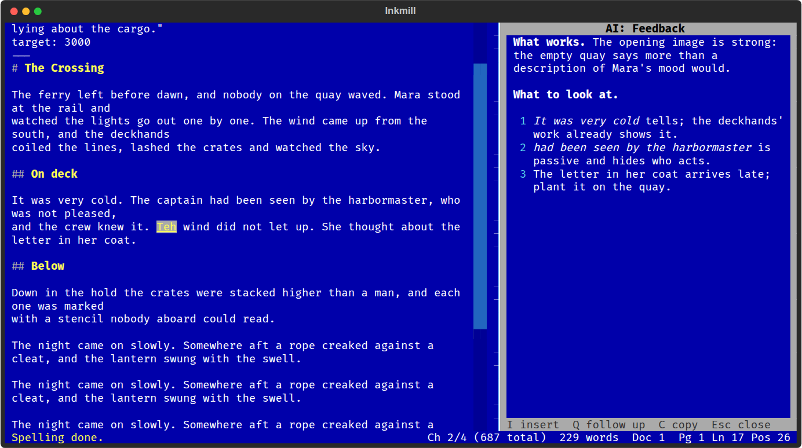

# AI Assistant

Help from a language model when you ask for it, and only then. Replies
appear in the side panel and never change your text on their own.



All commands are in the AI menu (Alt+A):

| Command | What it does |
|---------|--------------|
| Ask... | Any question about the selection, or about the whole document |
| Feedback | An editor's notes on the selection or the chapter: what works, and the three changes that would help most |
| Rewrite Selection... | Three versions of the selection (tighter, warmer, simpler: you say how); press 1, 2 or 3 to use one |
| Summarize | A short summary and the key points |
| Write Synopsis | One or two sentences for the chapter, which you can edit before it is saved to front matter (and shown in Binder's outline) |
| Continuity Check | Reads the whole binder and its research notes and lists names, dates, places and facts that disagree, quoting both passages |
| Set API Key... | Store your key |
| AI Settings... | Choose the provider, model and server |

In the reply panel: I inserts the reply at the cursor, R replaces the text
you selected, 1 to 3 pick a rewrite, Q asks a follow-up question in the same
conversation, C copies the reply, and Esc closes the panel (and stops a
reply still arriving).

## Providers

| Provider | Needs |
|----------|-------|
| Claude (Anthropic), the default, model `claude-sonnet-5-5` | An API key from console.anthropic.com |
| Ollama, on this computer | [Ollama](https://ollama.com) running with a model pulled (`ollama pull llama3.1`); nothing leaves your machine and no key is needed |
| OpenAI-compatible server | Its address, a model name and, usually, a key; works with LM Studio, llama.cpp's server and hosted services that speak the same API |

The Continuity Check sends a long manuscript once and asks about it; with
Claude, that part of the request is cached, so following up costs much
less than the first question.

## Privacy

Nothing is sent until you run an AI command, and only the text that command
names: the selection, the document, or for Continuity Check the binder and
its research notes (it asks first, with the size). The first request to
each server asks for your permission. Keys are read from
`ANTHROPIC_API_KEY` or `OPENAI_API_KEY` in your environment, or from a file
in the `ai` folder beside settings.toml that only your user can read. They
are never written to settings.toml.

## Settings

```toml
[plugins.ai]
provider = "anthropic"     # or "ollama", "openai"
model = "claude-sonnet-5-5"
base_url = ""              # a different server address
max_tokens = 2048
max_tokens_long = 4096     # for Continuity Check
max_context_chars = 600000
```
