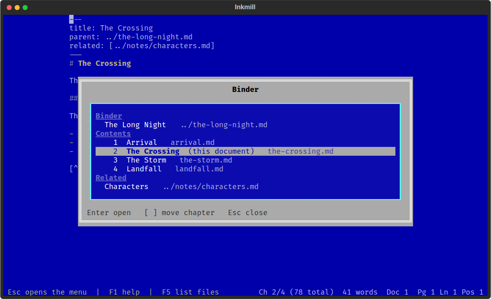
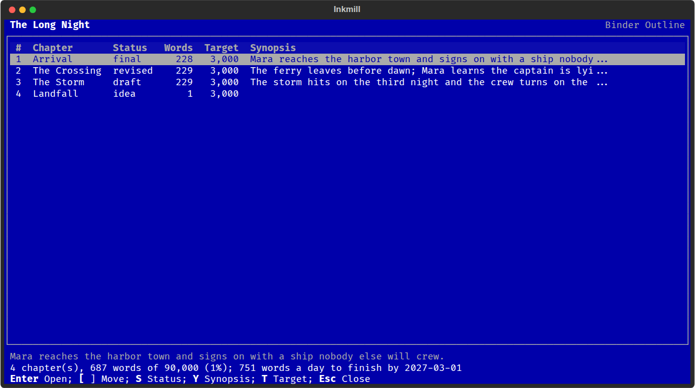

# Binder

Write long work as separate documents and keep them connected. A chapter
knows its binder (the overall document), the binder knows the chapters in
order, and any document can list related ones. Everything is stored in
front matter, so the files stay plain Markdown that other tools can read.

## Front matter

```yaml
---
title: The Crossing
parent: ../the-long-night.md
related: [notes/characters.md, research/ships.md]
---
```

The binder holds the reading order:

```yaml
---
title: The Long Night
author: A. Writer
contents:
  - chapters/arrival.md
  - chapters/the-crossing.md
  - chapters/the-storm.md
---
```

| Key | Meaning |
|-----|---------|
| `parent` | The binder this document belongs to. A list is allowed. |
| `contents` | In a binder: its documents in order. An entry can itself be a binder (a part holding chapters). |
| `previous`, `next` | Explicit neighbors. Use them to chain documents with no binder; they win over the binder's order. |
| `related` | Other documents this one relates to. |
| `research` | In a binder: notes, files, folders and web addresses that support the work. |
| `status`, `synopsis`, `target` | A chapter's state, summary and word target. A binder can have a `target` and a `deadline`. |

Paths are relative to the document's own folder and use forward slashes, so
they work on Windows, Linux and Android and survive moving the whole
project. `up` and `prev` are read as `parent` and `previous`. Inkmill only
rewrites the keys it manages; the rest of your front matter, comments
included, is left alone.

## Commands

All in the Binder menu (Alt+I):

| Command | Key | What it does |
|---------|-----|--------------|
| Binder... | Alt+F5 | The binder, its contents, neighbors, related documents, research and documents that link here |
| Binder Outline... | | Every chapter with status, words, target and synopsis (below) |
| Previous Chapter / Next Chapter | Alt+PgUp / Alt+PgDn | Open the neighbor |
| Up to Binder | Alt+Up | Open the binder |
| Set Status... | | idea, outline, draft, revised, final, or your own list |
| Set Synopsis... | | One or two sentences, shown in the outline |
| Link Document... | | Set the binder, previous, next, a related document, or research |
| Remove Link... | | Remove one, and optionally the link back |
| New Next Chapter... | | Create the next file (`chapter-03.md` after `chapter-02.md`) and put it in order |
| New Binder Document... | | Start a binder with this document as its first entry |
| New Research Note... | | A note in `research/` listed under the binder's research |
| Clip Web Page... | | Save a web page's text as a research note, with its address |
| Add Research... | | List a file, a folder or a web address under research |
| Check Links | | Report links to missing files |
| Preview Manuscript / Export Manuscript... | | The whole binder as one styled HTML page |

In the Binder list, Enter opens the highlighted entry: a document in
Inkmill, a folder in List Files, a PDF or image in its usual app, and a web
address in the browser. `[` and `]` move a chapter up or down.

Link Document asks whether to update the other file too, so adding a
binder as `parent` also adds this document to the binder's `contents`.
Renaming or moving a file in List Files updates the links that pointed at
it from the documents it links to and from documents in the same folder or
the folder above. The Binder list's "Linked from" section looks in the
document's folder, the folder above and the folders directly below.

Some terminals do not pass Alt+PgUp, Alt+PgDn or Alt+Up through. The Binder
list (Alt+F5) always works, and any key can be rebound under `[keys]`.



## Research

Research supports the work without being part of it: notes, clipped pages,
PDFs, folders of images, web addresses. It is listed in the binder's front
matter and never appears in the manuscript.

```yaml
research:
  - research/ships.md
  - research/maps/
  - https://en.wikipedia.org/wiki/Square_rig
```

New Research Note and Clip Web Page create notes in a `research` folder next
to the binder (setting `research_folder`) and link them both ways. Clipping
keeps a page's main text, headings, lists, quotes and links, and drops
navigation and scripts. The AI Assistant's Continuity Check reads research
notes along with the manuscript, and its Save Conversation as Research Note
command adds a conversation with Claude the same way. To turn a loose
document that already has a Claude Code conversation into a binder
without losing it, see "From an idea to a binder" in the AI Assistant's
README.

## Binder Outline



One row per chapter: number, title, status, words, word target and the
start of the synopsis, with the full synopsis of the highlighted chapter
below. The totals line shows the binder's words against its target and the
pace needed to meet its deadline (set with Progress > Project Target, or
`target` and `deadline` in the binder's front matter).

| Key | What it does |
|-----|--------------|
| Enter | Open the chapter |
| [ and ] | Move it up or down |
| S | Set its status |
| Y | Edit its synopsis |
| T | Set its word target |

## The manuscript

Preview and Export Manuscript join every chapter of the binder, in order,
into one HTML page using the current HTML style. Chapters without a heading
get their title as one. Footnotes stay with their own chapter even when two
chapters both use `[^1]`. Page breaks fall between chapters when printing.

The status line shows `Ch 2/14 (48,900 total)` in a chapter, and the binder
word count in the binder itself.

## Settings

```toml
[plugins.binder]
status = true                # chapter number and total in the status line
chapter_titles = true        # add a heading to chapters that have none
include_binder_text = false  # put the binder's own body first in the manuscript
research_folder = "research" # where new research notes and clips go
statuses = ["idea", "outline", "draft", "revised", "final"]
```
