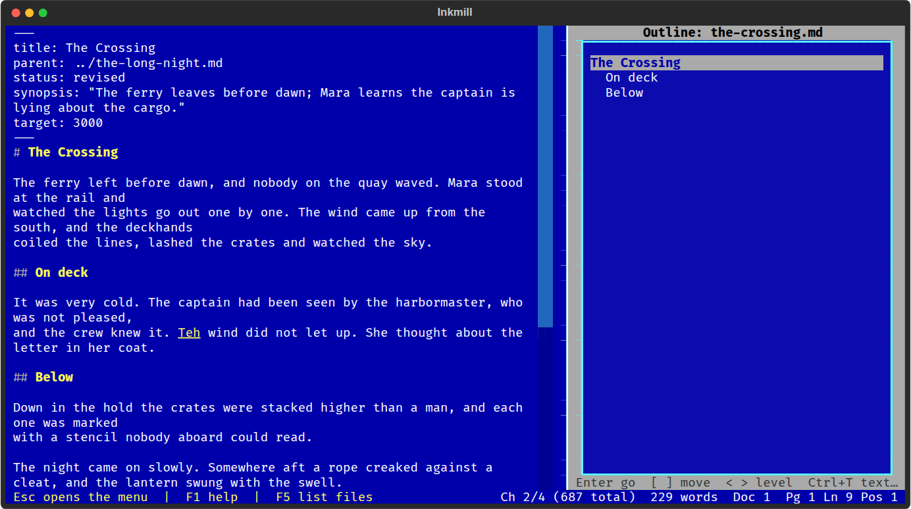

# Outline

The document's headings in the side panel, for finding your way around a
long chapter and for moving whole sections.

F8 (or Document > Outline) opens and closes it. In the list:

| Key | What it does |
|-----|--------------|
| Enter | Jump to the heading |
| [ and ] | Move the section up or down past its neighbor at the same level |
| < and > | Promote or demote the heading and every heading inside it |
| Ctrl+T | Back to the text with the outline still open |
| Esc | Close the outline |

A section is a heading plus everything up to the next heading at the same
or a higher level, so moving one moves its subsections too. Each move is a
single edit, so Ctrl+Z undoes it. The list follows your typing while it is
open. Headings inside code blocks and front matter are ignored.
