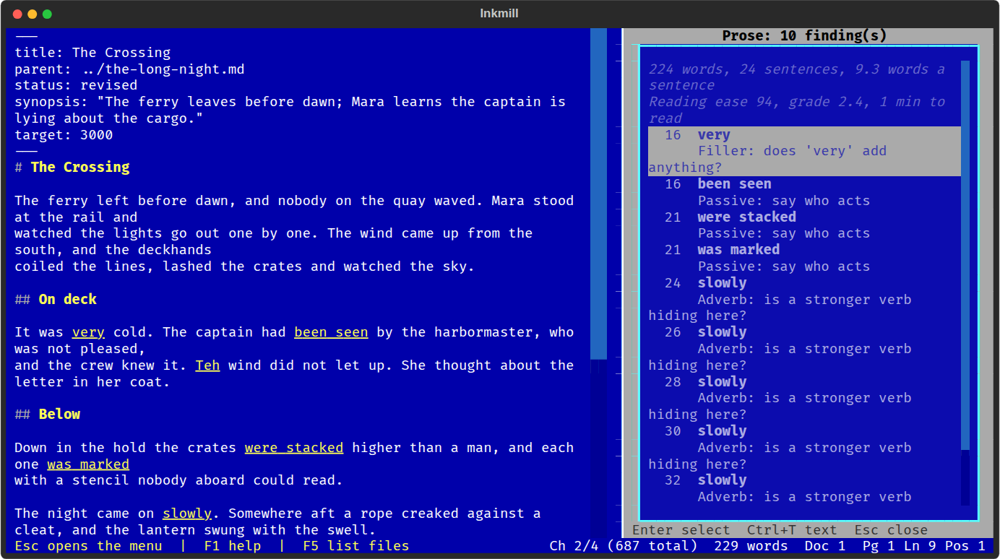

# Prose Check

Points at places worth a second look, with readability numbers, in the side
panel. It does not change anything.



Tools > Prose Check opens and closes it. The top line gives the word and
sentence counts, the average sentence length, Flesch reading ease and grade
level, and reading time. Below are the findings; Enter selects the passage
in the text. The list and the highlights follow your edits while the panel
is open.

| Check | Looks for |
|-------|-----------|
| Passive voice | "was thrown", "had been seen" |
| Adverb | words ending in -ly that a stronger verb might replace |
| Filler | very, really, just, quite, actually, sort of... |
| Wordy phrase | "in order to", "due to the fact that", with a shorter form |
| Cliche | "all of a sudden", "at the end of the day"... |
| Repeated word | "the the" |
| Weak opener | sentences starting "There was" or "It is" |
| Long sentence | more than 35 words (setting `long_sentence`) |
| Repeated start | three sentences in a row beginning with the same word |

These are heuristics: some passive sentences are the right choice. Tools >
Prose Check Options turns individual checks off.

## Vale

If [Vale](https://vale.sh) is installed and there is a `.vale.ini` in the
document's folder or any folder above it, Vale's findings are listed too,
so your house style rules apply alongside the built-in checks. Vale is
optional; the plugin works without it.

## Settings

```toml
[plugins.prose]
rules = ["passive", "adverb", "filler", "wordy", "cliche", "repeat", "opener", "long", "starts"]
long_sentence = 35
use_vale = true
vale_config = ""     # a .vale.ini to use instead of searching for one
```
