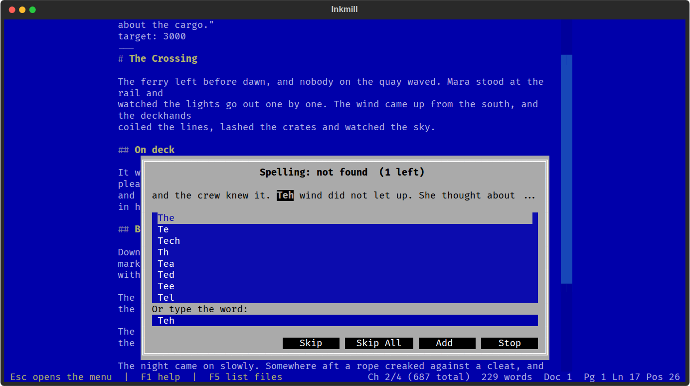

# Spelling & Thesaurus

Check spelling the way WordPerfect did, one word at a time in context, and
see unknown words underlined as you write. A thesaurus looks up synonyms for
the word under the cursor.



| Command | Key | What it does |
|---------|-----|--------------|
| Tools > Check Spelling... | Ctrl+F2 | Walk through each unknown word in the document, or in the selection |
| Tools > Thesaurus... | Alt+F1 | Synonyms for the word under the cursor; Enter replaces it |
| Tools > Underline Misspellings | | Turn the as-you-type underline on or off |
| Tools > Add Word to Dictionary | | Accept the word under the cursor from now on |
| Tools > Edit Personal Dictionary | | Open your word list; saving it applies the change |

In the spell check box, Enter takes the highlighted suggestion, typing in the
field and pressing Enter uses your own fix, and S, I and A skip, skip every
occurrence this session, or add the word to your dictionary. Esc stops.

Front matter, code, links, web addresses and footnote labels are never
checked. Words starting with a capital pass when the lowercase form is a
word, and short all-capital words (NASA, BBC) pass as abbreviations.

## Dictionaries

The plugin ships a US English list of about 124,000 words from SCOWL
(license in `dictionaries/SCOWL-LICENSE.txt`), so checking works offline.
Your additions go in `dictionaries/personal.txt` beside settings.toml. Any
other `.txt` file in that folder, one word per line, is added too: drop in a
list of character names, technical terms, or another language's words.

## Thesaurus

Synonyms come from the free Datamuse service (api.datamuse.com), so the
thesaurus needs a network connection. Only the single word is sent.

## Settings

```toml
[plugins.spelling]
underline = true    # underline unknown words as you write
```
